<div align="center">




[Introduction](#introduction) •
[Features](#features) •
[Requirements](#system-requirements) •
[Installation](#installation) •
[Usage](#usage) •
[Development](#development-progress) •
[Architecture](#planned-architecture) •
[Privacy & Security](#privacy--security) •
[License](#license)

</div>

## Introduction

**Diagmote** is an open-source remote diagnostics and technical
support platform designed to collect system information, monitor
computer resources, diagnose network connectivity and provide
tools for remote technical assistance.

The project aims to simplify computer monitoring and troubleshooting
through a modular architecture, helping technicians inspect system
conditions and identify potential problems.

Diagmote is currently in its early development stage. Its initial
prototype focuses on local system monitoring, process inspection
and active network diagnostics. Client-server communication, desktop
applications for users and technicians, and remote support capabilities
are planned for future development.

## Features

### Current implementation

- **System Monitoring**
  - CPU usage and processor information.
  - RAM utilization and available memory.
  - Disk utilization and available storage.
  - Operating system and hardware architecture.
  - System boot time and uptime.
- **Process Monitoring**
  - Running process identification.
  - Process ID, name and status.
  - CPU and RAM utilization.
  - Memory consumption.
- **Network Monitoring**
  - Network interface status.
  - IPv4 and IPv6 addresses.
  - Upload and download traffic.
  - Network errors and dropped packets.
  - Interface speed and MTU information.
- **Network Diagnostics**
  - ICMP ping connectivity tests.
  - DNS hostname resolution.
  - TCP connection verification.
  - Ping latency and packet loss measurements.
- **Data Collection**
  - Periodic collection at defined intervals: system and network metrics
    every 5 seconds, process metrics every 15 seconds, and connectivity
    diagnostics every 60 seconds.
  - CSV-based metric storage.
  - Console output for diagnostic information.
- **Automated Testing**
  - Unit and integration tests with _pytest_.
  - Behavior-driven development tests with _Behave_.
  - Automated test execution through _GitHub Actions_.

### Planned Features

- Client-server architecture.
- Desktop application for monitored computers (Diagmote Agent).
- Remote web service for communication and session management (Diagmote Server).
- Desktop application for technicians (Diagmote Console).
- Integrated monitoring dashboard.
- Historical metrics and diagnostic reports.
- Authentication and encrypted communication.
- Permission-controlled remote operations.
- Additional diagnostic and troubleshooting tools.

## System Requirements

- Python 3.12 or later.
- Windows, Linux or macOS.
- Internet connectivity for external network diagnostics.
- The system `ping` utility available in the environment.

## Installation

1. Clone the repository:

```bash
git clone https://github.com/JGabrielJ/diagmote.git
cd diagmote
```

2. Create a virtual environment:

```bash
python -m venv .venv
```

3. Activate the virtual environment:

#### Linux / macOS

```bash
source .venv/bin/activate
```

#### Windows

```shell
.venv\Scripts\activate
```

4. Install the project dependencies:

```bash
python -m pip install -r requirements.txt
```

## Usage

Start the monitoring prototype:

```bash
python -m client.main
```

The prototype periodically collects system metrics, process information
and network data, while performing active connectivity diagnostics.

### Data Storage

Collected information is automatically stored in the `data/` directory:

| **File**                 | **Description**                                       |
| ------------------------ | ----------------------------------------------------- |
| system_metrics.csv       | General system information and resource utilization.  |
| process_metrics.csv      | Running process information and resource consumption. |
| network_metrics.csv      | Network interface statistics and traffic.             |
| connectivity_metrics.csv | Active network diagnostic results.                    |

These files are generated locally and are not automatically uploaded
to any remote server. They may contain machine-specific information,
such as hostnames, local IP addresses, process names and system details.
Review their contents before sharing them.

## Development Progress

The project is being developed incrementally, with automated testing
and continuous integration.

### Phase 1 — Prototyping

- [x] System monitoring
- [x] Process monitoring
- [x] Network monitoring
- [x] Active connectivity diagnostics
- [x] System information and uptime
- [x] Automated tests
- [x] GitHub Actions CI
- [x] Final documentation and repository preparation

### Phase 2 — Client-Server Architecture

- [ ] Diagmote Agent architecture
- [ ] Diagmote Server implementation
- [ ] Client-server communication
- [ ] Authentication and authorization
- [ ] Secure communication (TLS)
- [ ] Session management
- [ ] Database integration

### Phase 3 — Diagmote Console

- [ ] Desktop application foundation
- [ ] Computer and session management
- [ ] Server integration
- [ ] Diagnostic interface

### Phase 4 — Dashboard

- [ ] System metrics visualization
- [ ] Historical data and charts
- [ ] Resource usage monitoring
- [ ] Network performance visualization

### Phase 5 — Remote Support

- [ ] Remote commands with explicit authorization
- [ ] Remote configuration management
- [ ] File transfer, if applicable
- [ ] Remote screen viewing, with user consent

### Future Improvements

- [ ] Additional diagnostic tools
- [ ] Performance optimization
- [ ] Additional platform support

## Planned Architecture

The planned architecture consists of two desktop applications connected
through a remote server:

- **Diagmote Agent — monitored computer**
  - A desktop application installed and run by the person receiving support.
  - Collects system and network information.
  - Presents session information and requests the user's consent.
  - Performs only explicitly authorized diagnostic or support operations.
- **Diagmote Server — remote service**
  - A web service responsible for communication between Agent and Console.
  - Receives and processes collected information.
  - Manages authentication, connections and support sessions.
  - Routes authorized requests between the desktop applications.
  - Flask is the current framework choice for its planned implementation.
- **Diagmote Console — technician's computer**
  - A desktop application used by the support technician.
  - Connects to the Server to manage monitored computers and sessions.
  - Provides diagnostic and support tools.
  - Includes the **Dashboard** as an internal module for metrics, charts and
    historical information.

The Agent and Console are planned as separate desktop applications. The
Server will operate independently as a remotely hosted service; the Dashboard
will be part of the Console rather than a separate application.

## Privacy & Security

Privacy and security are important design considerations for Diagmote.

The current prototype operates locally and stores collected information
in CSV files. It does not currently implement remote client-server
communication, authentication or encrypted data transmission.

Future remote capabilities are intended to follow security-oriented
principles, including authenticated communication, explicit user consent,
restricted operations and audit logging.

**Diagmote is an experimental prototype and should not yet be deployed as**
**a remote administration or production support solution.**

## License

Diagmote is distributed under the terms of the **GNU Affero General Public**
**License v3.0 (AGPL-3.0)**. You may use, study, modify and redistribute the
software under the conditions described in the [`LICENSE`](./LICENSE) file.

> Copyright (c) 2026 Gabriel Jacinto.

## Contact

For project questions, bug reports and feature requests, please use
[GitHub Issues](https://github.com/JGabrielJ/diagmote/issues) or visit
the [project owner's GitHub profile](https://github.com/JGabrielJ).
